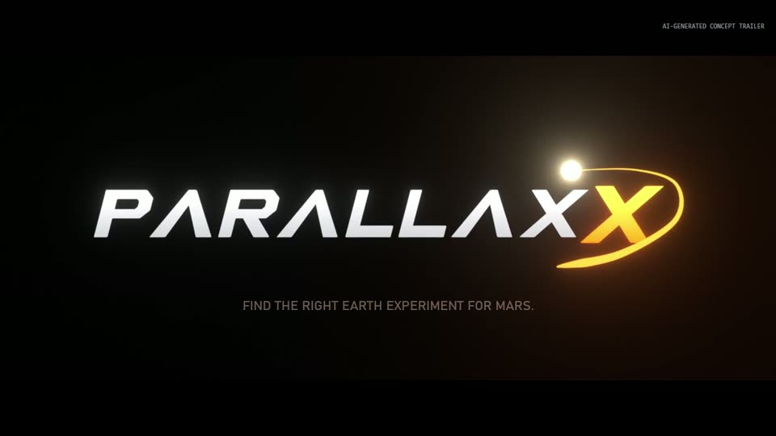
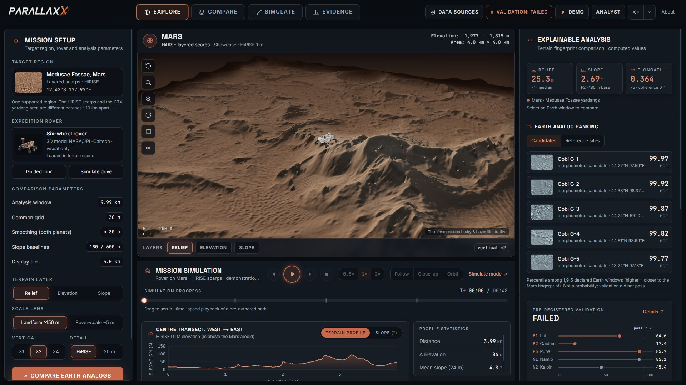
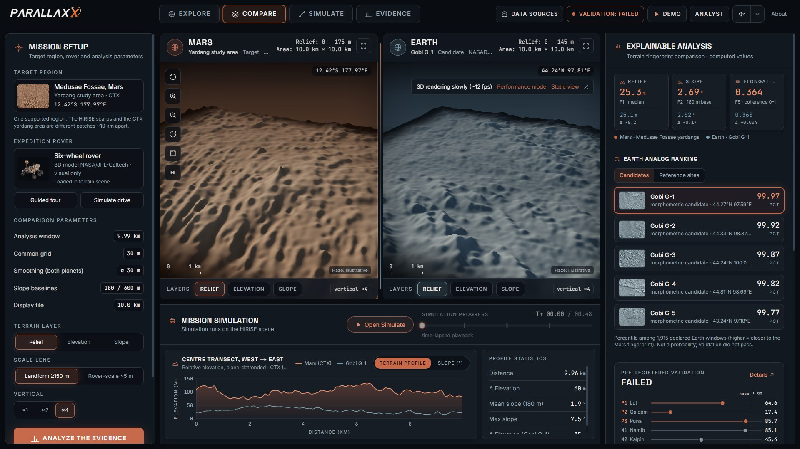
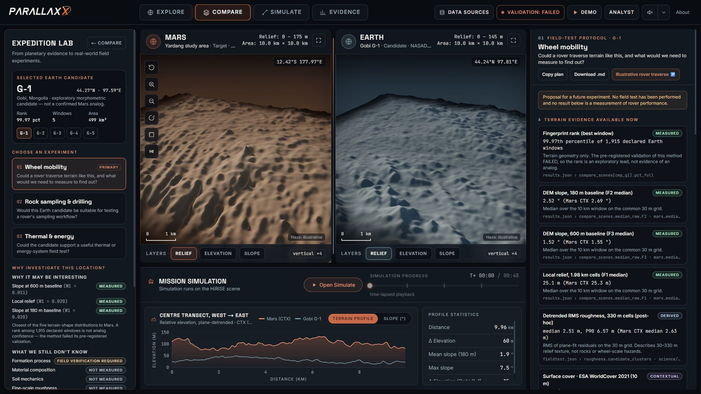

<p align="center">
  
</p>

<p align="center"><strong>An evidence-first Mars–Earth analog explorer that turns terrain measurements into transparent field-test questions.</strong></p>

<p align="center">
  NASA Space Apps Challenge 2026 · Ulaanbaatar · Challenge: “Identify Earth Locations that Analog the Permanent Moon Base Locations and Mars”
</p>

<p align="center">
  <a href="https://parallax-x-lyart.vercel.app"><strong>▶ Open the live application</strong></a> ·
  <a href="#expedition-lab">Explore Expedition Lab</a> ·
  <a href="docs/METHOD.md">Method</a> ·
  <a href="docs/LIMITATIONS.md">Limitations</a>
</p>

---

<p align="center">
  <a href="https://github.com/V01D-404/All-demo-and-loading/blob/main/sp-MA0PXF2Ej67IDvi0kpA.mp4">
    
  </a>
  <br />
  <a href="https://github.com/V01D-404/All-demo-and-loading/blob/main/sp-MA0PXF2Ej67IDvi0kpA.mp4"><strong>Watch the brand film (22 s)</strong></a>
  <br />
  <sub>AI-generated concept brand film by team member Khuslen (V01D-404). It is not live app footage or a scientific simulation. The other four concept films are listed under <a href="#motion--concept-films">Motion &amp; concept films</a>.</sub>
</p>

## What is PARALLAX X?

PARALLAX X asks three questions about one specific Martian landscape, the wind-carved yardangs of the **Medusae Fossae Formation**.

| | Question | What the app does |
|---|---|---|
| **Where?** | Which Earth places resemble it? | A pre-registered fingerprint of five terrain-shape features from the **CTX yardang study area** is compared (Wasserstein-1) with **1,915 declared Earth windows**. The result is five **exploratory** candidate clusters in Mongolia's Gobi, G-1…G-5. |
| **Why?** | What supports the resemblance, and where does it break down? | Matched-scale 3D (same 10 km, same 30 m grid), per-feature distances, the reference sites, and a pre-registered validation that **failed**. |
| **What next?** | What would a rover field test have to measure? | **Expedition Lab** turns a candidate's evidence into a deterministic field-test protocol and marks every property that satellite data cannot provide as *not measured*. |

<table>
  <tr>
    <td width="33%"><br /><sub><b>Mars, HiRISE scarp scene.</b> Measured stereo elevation in 3D. The rover is an illustrative visualization.</sub></td>
    <td width="33%"><br /><sub><b>Matched-scale comparison.</b> Mars CTX study area beside Gobi G-1: 10 km, 30 m grid, ×4 on both.</sub></td>
    <td width="33%"><br /><sub><b>Expedition Lab.</b> A wheel-mobility protocol for G-1, with evidence classes and the unmeasured properties listed.</sub></td>
  </tr>
</table>

## The result, stated plainly

The study design, including the pass/fail rule, was **pre-registered and committed before any Mars–Earth distance was computed** (commit `32b5c48`, [`science/prereg.md`](science/prereg.md)).

**Pre-registered validation: FAIL.**

| Test (pre-registered) | Outcome |
|---|---|
| ≥ 2 of 3 published Earth yardang fields rank at or above the 90th percentile | **0 of 3**: Lut Kaluts 64.6, Qaidam 17.4, Puna 85.7 (median window percentile) |
| The full 5-feature fingerprint beats a slope-only baseline | **No**: 55.9 vs 63.0 |
| Yardang fields rank above process-different look-alikes | **No**: Namib linear dunes 85.1 rank higher; Kalpin thrust ridges 45.4 |

- **What it means.** At the scale where public 30 m Earth elevation can be compared fairly with Mars, this terrain-geometry fingerprint cannot reliably separate yardangs from other terrain.
- **Sensitivity.** 6 km windows give the same result (FAIL). An independent-DEM check (Copernicus GLO-30) is reported in the app.
- **The resolution paradox.** On the separate 1 m HiRISE crop, **13.9 %** of the area is steeper than 15° at a ~4 m baseline, but only **1.6 %** at 180 m. A place can look similar at one scale and behave very differently at another.
- **Gobi candidates.** G-1…G-5 are **exploratory morphometric candidates**, not confirmed analogs. They need imagery, geology and field checks.

Our contribution: we built an analog-search method, tested it, showed where it fails, and turned the remaining uncertainty into explicit field-test questions.

## Expedition Lab

In **Compare**, select a Gobi candidate, then press **Plan a field experiment**. In **Evidence → 3 · Where on Earth?**, press **Design a field test**.

- **The layout.**
  - Left: the candidate and an experiment selector.
  - Centre: the matched-scale 3D comparison stays on screen.
  - Right: the protocol.
- **The three experiments.**
  - **Wheel mobility** (primary). It shows the candidate's measured slope, relief, roughness and land cover. It lists what is **not measured**: traction, soil bearing and shear strength, sinkage, wheel-scale rocks and mobility safety. It also gives the slip ratio *s = 1 − v/(r·ω)*, energy per metre and sinkage, instruments, a controlled procedure, repeated trials, data-quality checks and Earth→Mars limitations. Acceptance thresholds are **TO BE DEFINED** from real mission requirements.
  - **Rock sampling & drilling**, and **Thermal & energy**. These are concise protocols. They do not infer drillability from topography and do not predict battery endurance.
- **Evidence classes.** Every value is labelled one of:
  - *Measured*
  - *Derived*
  - *Contextual*
  - *Not measured*
  - *Field verification required*
- **Export.** Any plan can be copied or downloaded as Markdown. The protocols are proposals: **no field test has been performed**.
- **The rover.** The traverse button shows the rover on the **separate HiRISE Mars scene**, labelled "Illustrative terrain-following visualization · not a validated mobility simulation". It never drives on a Gobi candidate.
- **How plans are built.** Protocols come from [`lib/expedition.ts`](lib/expedition.ts) (deterministic, unit-tested) using [`public/data/results.json`](public/data/results.json) and [`public/data/fieldtest.json`](public/data/fieldtest.json).

## Science and data

- **Search region.** The CTX stereo DTM of the Medusae Fossae yardangs is the only Mars input to the ranking.
- **Separate HiRISE scene.** The 1 m HiRISE scarp scene, about 10 km away, is a separate fine-scale demonstration: 3D exploration, the rover visualization and the resolution paradox. It did not produce the Earth matches.
- **Pipeline.** Offline Python (rasterio, NumPy, SciPy):
  1. NoData masking;
  2. reprojection to a local 30 m metric grid;
  3. identical smoothing on both planets;
  4. five features: relief, slope at 180 m and 600 m, TPI, ridge elongation;
  5. ECDF normalisation against the declared null;
  6. 1-D Wasserstein distances;
  7. percentiles among the 1,915 null windows.

  No machine-learning model was trained.
- **Post-hoc, descriptive only.** These two layers are logged in [`science/DEVIATIONS.md`](science/DEVIATIONS.md). Neither enters F1–F5, the ranking or the verdict.
  - Local detrended RMS roughness: 330 m and 990 m cells on the same 30 m grid.
  - ESA WorldCover 2021 v200 land-cover fractions inside the exact candidate footprints.
- **Data sources.**
  - NASA PDS HiRISE DTM `DTEEC_009609_1675_010453_1675_A01`
  - USGS CTX DTM `P16_007460_…_13S182W`
  - NASA NASADEM (LP DAAC)
  - Copernicus GLO-30
  - ESA WorldCover 2021 v200
  - MGS MOLA
  - Natural Earth

  Full list and licences: [`docs/DATA_SOURCES.md`](docs/DATA_SOURCES.md).

Details: [`docs/METHOD.md`](docs/METHOD.md) · [`docs/DATA_CONTRACT.md`](docs/DATA_CONTRACT.md) · [`science/prereg.md`](science/prereg.md).

## In the app

- **Welcome intro.** Skippable, once per session, reduced-motion safe. It offers an optional **Watch the brand film** button.
- **Select.** The real MOLA locator, true-size data footprints and coverage legend, with two real scenes.
- **Explore and Simulate.** HiRISE terrain in 3D, the illustrative rover on a hand-drawn loop with a linked terrain profile, and the Resolution Paradox.
- **Compare.** Mars and Earth at matched scale, with live transects, the ranking and **Plan a field experiment**.
- **Evidence.** The animated W1 math, the falsification reveal (FAIL), and a candidate dossier.
- **Research analyst.** Rule-based templates over `results.json`. It is not an AI model.
- **Judge demo.** Press the **Demo** button or **J**. It runs five acts in about 30 s, and Esc skips it.
- **Films & concepts.** The team's AI-generated concept films. Nothing autoplays, and video is streamed only when you press play.

Screenshots of the production site at 1920×1080, 1440×900, 1366×768 and 390×844 are in [`docs/screenshots/`](docs/screenshots/).

## Motion & concept films

These are five AI-generated concept films by **Khuslen (V01D-404)**. The originals are in [V01D-404/All-demo-and-loading](https://github.com/V01D-404/All-demo-and-loading). They are creative media, not product footage and not scientific simulation. Full credits and rights status: [`docs/VISUAL_ASSETS.md`](docs/VISUAL_ASSETS.md).

| Film | Role | Length | Where it is used |
|---|---|---|---|
| [05 · Brand film](https://github.com/V01D-404/All-demo-and-loading/blob/main/sp-MA0PXF2Ej67IDvi0kpA.mp4) | Brand identity | 22 s | Top of this README; *Watch the brand film* in the intro, the Select header and the About dialog |
| [01 · Mission concept](https://github.com/V01D-404/All-demo-and-loading/blob/main/9pI2U-Trq3OJg750Em2SOA.mp4) | AI storyboard (video and voice) | 29 s | Films & concepts gallery |
| [02 · Boot sequence concept](https://github.com/V01D-404/All-demo-and-loading/blob/main/BhQdikMpZvAtfHuSe7zAGA.mp4) | Motion reference | 17 s | Films & concepts gallery. It is not used as a loading screen. |
| [04 · Expedition Lab interface concept](https://github.com/V01D-404/All-demo-and-loading/blob/main/XMBeQxLFT_O4OuPIsVrD5w.mp4) | Early interface concept | 28 s | Films & concepts gallery. It is labelled as not the implemented workflow (it shows Jezero, C1–C3 and rover slope limits). |
| [03 · Character study](https://github.com/V01D-404/All-demo-and-loading/blob/main/QxKAs5cM7ujcN5VVWQ8ycg.mp4) | Early motion exploration | 12.5 s | Films & concepts gallery |

## Run locally

```bash
npm install
npm run dev            # http://localhost:3000
npm run typecheck && npm run lint && npm test
npm run build          # static export to out/
science/.venv/Scripts/python -m pytest science/tests -q   # needs the downloaded science data
```

Reproducing the science: [`docs/METHOD.md`](docs/METHOD.md#reproduce).

## Verification

These checks were run for the current release:
- the TypeScript typecheck;
- ESLint;
- the Vitest suite. It covers the brand-file integrity, the Expedition Lab dossiers (no fabricated values, exact source values) and the pre-registered invariants: 1,915 windows and FAIL with 64.6 / 17.4 / 85.7 / 85.1 / 45.4 and 55.9 vs 63.0;
- the Python science tests, including numerical tests of the roughness calculation;
- the production build.

Browser checks were done on the deployed site. Known limitations are listed in [`docs/LIMITATIONS.md`](docs/LIMITATIONS.md).

## Credits, AI use and licences

- **Team.** PARALLAX X, NASA Space Apps 2026, Ulaanbaatar.
  - Repository owner: BeBecpp.
  - Concept films: Khuslen (V01D-404).
- **AI assistance** ([`docs/AI_USAGE.md`](docs/AI_USAGE.md)):
  - **Claude Code** (Anthropic) generated most of the code, the pipeline, tests and documentation under the team's direction.
  - **ChatGPT** (OpenAI) was used to a smaller extent for research discussion and concept refinement.
  - The concept films are AI-generated.
  - **The deployed site makes no AI or LLM API calls.**
- **Rover model.** NASA/JPL-Caltech *Mars 2020 Perseverance* (NASA 3D Resources), with the insignia removed. See [`docs/ROVER_MODEL.md`](docs/ROVER_MODEL.md).
- **Third-party data, assets and dependencies.** See [`THIRD_PARTY_NOTICES.md`](THIRD_PARTY_NOTICES.md). Audio credits: [`docs/AUDIO_CREDITS.md`](docs/AUDIO_CREDITS.md). Prior art: [`docs/PRIOR_ART.md`](docs/PRIOR_ART.md).
- **Licence.** The open-source licence for the team's original code is **pending team approval**, so no `LICENSE` file is included yet. See [`THIRD_PARTY_NOTICES.md`](THIRD_PARTY_NOTICES.md#licence-status). Data, the rover model and the concept films keep their own terms.

Not affiliated with or endorsed by NASA.
